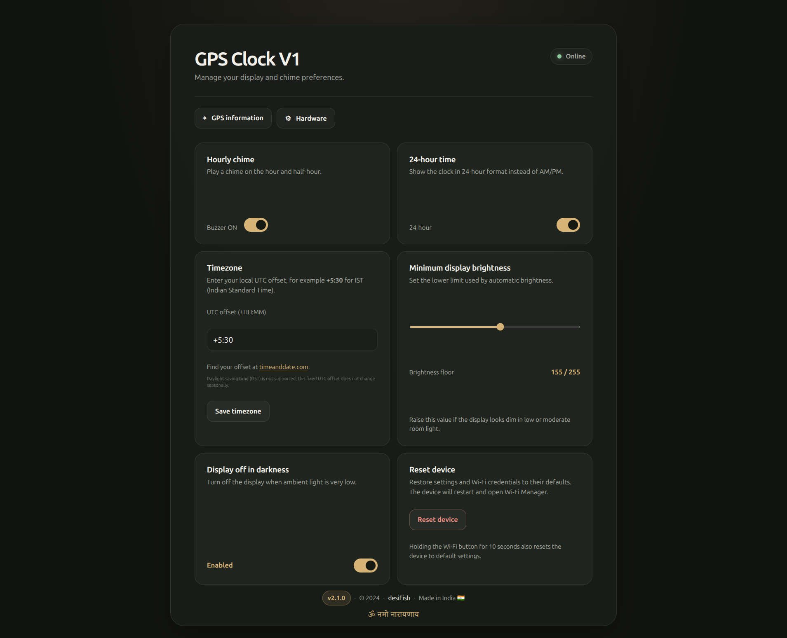
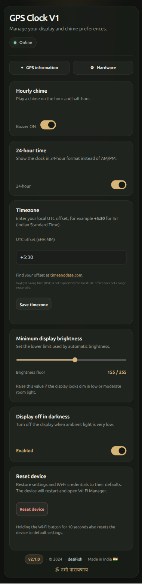
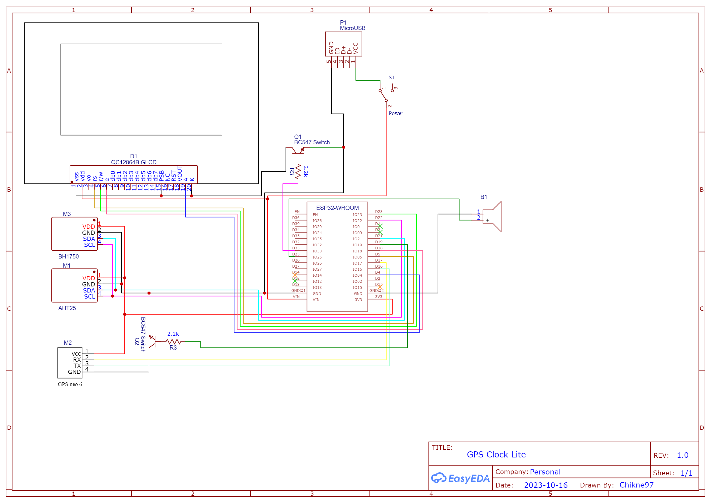
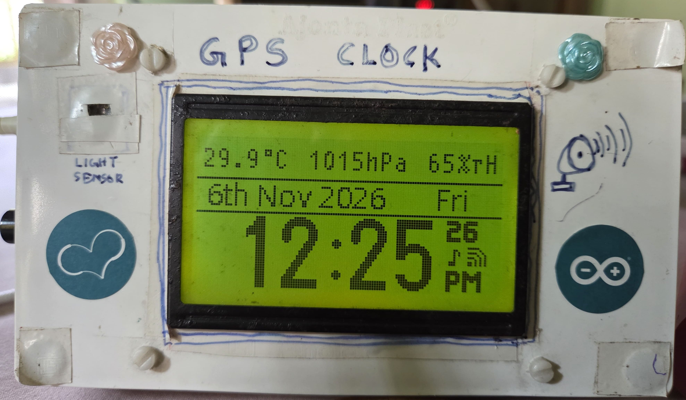

  
  <h1> 🌟 ESP32 GPS Clock & Weather Station </h1>

  
  
  
  
  
  

  

    <i>ESP32 GPS Clock & Weather Station is an open-source project that combines an ESP32 microcontroller with a GPS receiver and environmental sensors to create a satellite-synchronized digital clock and weather monitor. It displays precise time, temperature, humidity, and atmospheric data, making it ideal for DIY electronics enthusiasts, Arduino/ESP32 hobbyists, and IoT developers who need reliable, real-time information. With built-in support for auto-brightness control, OTA updates, and expandable hardware, this project works as both a GPS-based timekeeping alternative to NTP and a compact home weather station.🛰️</i>
  

  <table>
    <tr>
      <td width="50%"></td>
      <td width="50%"></td>
    </tr>
  </table>

  ><h2>⚠️ Another Version Available ⚠️</h2>
  >
A different version of this project with physical buttons for better device configuration is available at: 
  ><a href="https://github.com/desiFish/ESP32-GPS-CLOCK-V2">ESP32-GPS-CLOCK-V2</a>

  >

<h2>✨ Features</h2>
<table>
  <tr>
    <td>🕒 Time</td>
    <td>GPS-synchronized time, selectable 12/24-hour display, and configurable fixed UTC offset</td>
  </tr>
  <tr>
    <td>🌡️ Environment</td>
    <td>BME280 temperature, humidity, and pressure monitoring</td>
  </tr>
  <tr>
    <td>🔆 Display</td>
    <td>Automatic brightness with an adjustable minimum and optional display-off-in-dark mode</td>
  </tr>
  <tr>
    <td>📱 Connectivity</td>
    <td>Wi-Fi Manager, browser-based settings, OTA updates, and reset-to-defaults</td>
  </tr>
</table>

  <h2 style="color: white;">🌟 Project Highlights</h2>
  <table style="background: rgba(255,255,255,0.1); border-radius: 8px;">
    <tr>
      <td>⚡ Fast GPS Lock</td>
      <td>🌙 Auto Brightness</td>
      <td>🔄 OTA Updates</td>
    </tr>
    <tr>
      <td>📱 WiFi Manager</td>
      <td>🔋 Battery Backup</td>
      <td>🌡️ Environment Monitor</td>
    </tr>
  </table>

<h2>🛠️ Hardware Requirements</h2>

<strong>Core Components 📋</strong>

| Component | Purpose | Notes |
|-----------|---------|--------|
| ESP32 devkit v1 | 🧠 Controller | DOIT version recommended |
| BH1750 | 💡 Light sensor | I²C interface |
| BME280 | 🌡️ Environment | Temperature/Humidity |
| GPS Neo 6m | 📡 GPS receiver | UART interface |
| ST7920 LCD | 🖥️ Display | 128x64 pixels |
| Buzzer | 🔊 Alerts | Active buzzer |

<strong>Optional Components 🔧</strong>

- 🔋 LiFePO4 AAA 80mAh (GPS backup)
- ⚡ TP5000 charging circuit
- 🔌 BMS with IN4007 diode
- 🛠️ Prototyping materials

<strong>Required Libraries 📚</strong>

| Library | Source | Notes |
|---------|--------|-------|
| TinyGPSPlus | Arduino Library Manager | GPS parsing |
| U8g2 | Arduino Library Manager | ST7920 LCD display |
| ArduinoJson | Arduino Library Manager | Web API/config JSON |
| Adafruit BME280 Library | Arduino Library Manager | Temperature, humidity, pressure |
| Adafruit Unified Sensor | Arduino Library Manager | Required by Adafruit BME280 |
| BH1750 | Arduino Library Manager | Ambient light sensor |
| ElegantOTA | Arduino Library Manager | OTA updates |
| AsyncTCP | [ESP32Async](https://github.com/ESP32Async/AsyncTCP) | Latest version |
| ESPAsyncWebServer | [ESP32Async](https://github.com/ESP32Async/ESPAsyncWebServer) | Latest version |

> ℹ️ **Note:** We use the libraries from ESP32Async repository as they are regularly maintained and updated.

<h2>🚀 Installation and first start</h2>

1. Install the ESP32 Arduino board support and the libraries listed above.
2. Connect the ESP32 to USB and upload `GPS-CLOCK-V1.ino` using the Arduino IDE or your preferred ESP32 toolchain.
3. Upload the complete `data/` directory to the device's LittleFS filesystem. The web interface, including Wi-Fi Manager, is served from these files; the clock can run without the pages, but browser setup and settings will not be available.
   - [Arduino IDE 2 LittleFS upload instructions](https://randomnerdtutorials.com/arduino-ide-2-install-esp32-littlefs/)
4. Restart the clock. On first start, or when Wi-Fi credentials have been cleared, it opens a setup access point:
   - **Network (SSID):** `WIFI_MANAGER`
   - **Password:** `WIFImanager`
5. Connect a phone or computer to that network and open [http://192.168.4.1](http://192.168.4.1). Enter the name and password of the 2.4 GHz Wi-Fi network the clock should join, then submit. The clock saves the credentials and restarts.
6. Once connected to your Wi-Fi, find the clock's IP address in your router or on the clock's display, then open `http://<clock-ip>/` in a browser.

The GPS receiver needs a clear view of the sky to acquire satellites. Time and date appear after a valid GPS fix. The clock does not need internet access for GPS timekeeping; Wi-Fi is used for the web settings and OTA updates.

<h2>🧭 Using the clock and web settings</h2>

Open the clock's IP address in a browser. Settings save when changed; there is no separate Save button except for the timezone field. The device gives a short beep after a setting is saved.

- **24-hour time:** Turn on to display hours from `00` through `23`. Turn off for 12-hour time with AM/PM.
- **Timezone:** Enter a signed UTC offset in `±HH:MM` format. For example, `+5:30` for IST is converted by the page to `19800` seconds and sent to the clock. Valid offsets range from UTC−12:00 to UTC+14:00. [Find a timezone offset](https://www.timeanddate.com/time/zones/).
- **Daylight saving:** DST is not supported. The clock uses the same fixed UTC offset throughout the year; update it manually when your local offset changes.
- **Minimum display brightness:** Adjust the lower brightness limit from 40 to 255. Automatic brightness still responds to the BH1750 light sensor.
- **Display off in darkness:** Enable to switch off the display when the light sensor detects darkness.
- **Hourly chime:** Enable or disable the buzzer's hourly and half-hourly chimes.
- **Device status:** The home page shows whether the browser can currently reach the clock.
- **GPS information / Hardware:** Use the links on the home page to view GPS and device details. The GPS page also offers a map link when coordinates are available.

<h3>Wi-Fi button</h3>

- Press and release to toggle Wi-Fi on or off. The display indicates the action; releasing the button restarts the clock to apply it.
- Hold the button for 10 seconds to clear saved settings and Wi-Fi credentials. Release it to restart into Wi-Fi Manager.

<h3>Reset settings</h3>

Use **Reset device** on the home page and confirm the prompt to clear saved settings and Wi-Fi credentials. The page shows a five-second countdown, then the clock restarts into Wi-Fi Manager. Connect to `WIFI_MANAGER` and enter the Wi-Fi credentials again. Reset defaults include Wi-Fi enabled, the buzzer off, 12-hour time, UTC+05:30, a minimum brightness of 70, and display-off-in-dark disabled.

<h3>OTA firmware updates</h3>

After connecting to Wi-Fi, open the clock's IP address followed by `/update` (for example, `http://192.168.1.50/update`) and follow the ElegantOTA page to upload firmware. OTA updates the firmware; when web files change, upload the complete `data/` directory to LittleFS separately using the filesystem uploader. For the first installation, use USB/serial and upload LittleFS separately.

<h3>Temperature sensor placement</h3>

Temperature readings can be higher than room temperature if the BME280 is close to the ESP32, which produces heat, or near the top of the enclosure where warm air rises. In this clock, moving the sensor to the lower part of the enclosure, away from the ESP32, resolved the consistently elevated readings. Keep the sensor clear of the ESP32 and other heat sources for more representative ambient readings.

  <h3>🎯 Key Features Explained</h3>
  <ul>
    <li>🕒 <strong>Timekeeping:</strong> GPS-synchronized time; an optional backup battery can help the GPS module retain its data between power cycles</li>
    <li>🌡️ <strong>Environmental Monitoring:</strong> BME280 temperature, humidity, and pressure readings</li>
    <li>📱 <strong>Connectivity:</strong> Wi-Fi setup and clock settings through a browser</li>
    <li>🔆 <strong>Adaptive Display:</strong> Automatic brightness with optional display-off-in-dark behavior</li>
  </ul>

<strong>🔋 GPS Battery Modification</strong>

  <h4>⚠️ Known Issue with GPS Module's Internal Battery</h4>
  

    The NEO-6M GPS modules often come with problematic internal rechargeable batteries that:
    <ul>
      <li>Are frequently dead on arrival</li>
      <li>Fail to hold charge properly</li>
      <li>Only last 15-20 minutes when disconnected</li>
      <li>Cannot be reliably recharged</li>
    </ul>
  

  <h4>🛠️ Solution Implemented</h4>
  

    To resolve this, I've made the following modifications:
    <ul>
      <li>Removed the internal battery and charging diode</li>
      <li>Installed a LiFePO4 battery (AAA size)</li>
      <li>Added TP5000 charging circuit for reliable charging</li>
      <li>Implemented BMS for deep discharge protection</li>
      <li>Added diode to drop voltage to 3V for GPS backup pin</li>
    </ul>
  

  <h4>💡 User Options</h4>
  

    <strong>You have two choices:</strong>
    <ol>
      <li><strong>Keep Original Battery:</strong> 
        <ul>
          <li>Suitable if clock remains powered most of the time</li>
          <li>No modifications needed</li>
        </ul>
      </li>
      <li><strong>Modify Battery (Recommended):</strong>
        <ul>
          <li>Better for frequent power cycles</li>
          <li>Eliminates 5-10 minute GPS lock delay on cold starts</li>
          <li>More reliable long-term solution</li>
        </ul>
      </li>
    </ol>
  

<h2>📊 Schematics</h2>

    <strong>👀 Circuit Diagram</strong>
     
    
    
<em>ESP32 GPS Clock Circuit Diagram</em>

  <table>
    <tr>
      <td>📝 Format</td>
      <td>High-resolution PNG</td>
    </tr>
    <tr>
      <td>🔍 Zoom</td>
      <td>Click image to enlarge</td>
    </tr>
    <tr>
      <td>💾 Download</td>
      <td><a href="https://github.com/KamadoTanjiro-beep/ESP32-GPS-CLOCK-V1/blob/main/resources/schematic/Schematic_GPSClock-V1.png">Full Resolution</a></td>
    </tr>
  </table>

<h2>📸 Gallery</h2>

  <table>
    <tr>
      <!-- First Row -->
      <td width="33%">
        
        
<em>Internal Components 🔧</em>

      </td>
      <td width="33%">
        
        
<em>PVC Case 🎨</em>

      </td>
      <td width="33%">
        
        
<em>Front View 📱</em>

      </td>
    </tr>
    <tr>
      <!-- Second Row -->
      <td width="33%">
        
        
<em>PCB Layout 🔌</em>

      </td>
      <td width="33%">
        
        
<em>Internal View 2 🔌</em>

      </td>
      <td width="33%"></td>
    </tr>
  </table>

<h2>📜 License</h2>

<h3>GNU General Public License v3.0</h3>

<h4>✅ Permissions</h4>
<ul>
  <li>Commercial use</li>
  <li>Modification</li>
  <li>Distribution</li>
  <li>Patent use</li>
  <li>Private use</li>
</ul>

<h4>⚠️ Conditions</h4>
<ul>
  <li><strong>License and copyright notice:</strong> Include the original license and copyright</li>
  <li><strong>State changes:</strong> Document all modifications</li>
  <li><strong>Disclose source:</strong> Make source code available</li>
  <li><strong>Same license:</strong> Use the same license for derivatives</li>
</ul>

<h4>❌ Limitations</h4>
<ul>
  <li>No liability</li>
  <li>No warranty</li>
</ul>

<h2>🤝 Contributing</h2>

  <table>
    <tr>
      <td>🍴 Fork</td>
      <td>🔧 Code</td>
      <td>📤 Push</td>
      <td>📫 PR</td>
    </tr>
  </table>

<h2>📞 Support</h2>

  
If this project helps you, please consider:

  

    ⭐ Giving it a star 
    🐛 Reporting issues 
    💡 Suggesting improvements 
    🤝 Contributing code
  

<h2>🎨 Credits</h2>

  <ul style="list-style: none;">
    <li><a href="https://www.flaticon.com/free-icons/clock" title="clock icons">Clock favicon created by Those Icons - Flaticon</a></li>
    <li>📚 Library maintainers of AsyncTCP and ESPAsyncWebServer</li>
    <li>🌟 The amazing open source community for their contributions and support</li>
  </ul>

---

  
Made with ❤️

  
  

